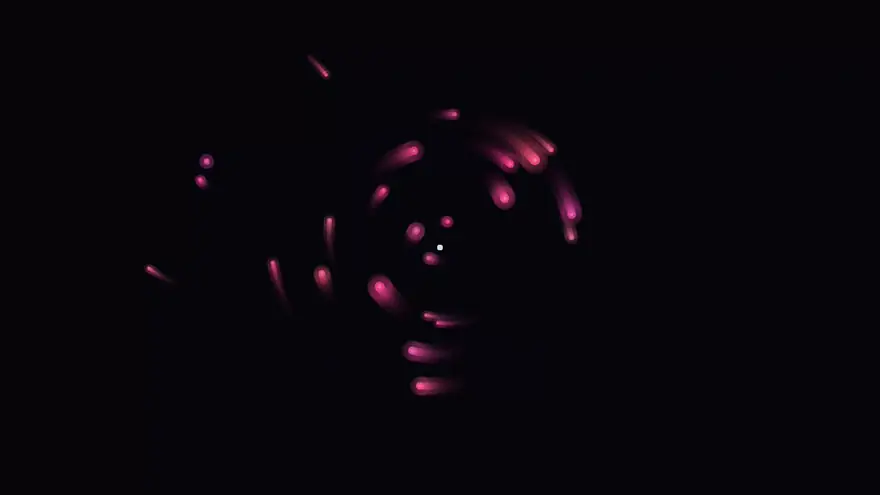
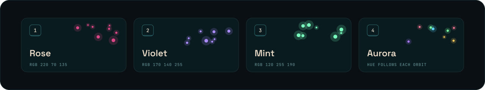
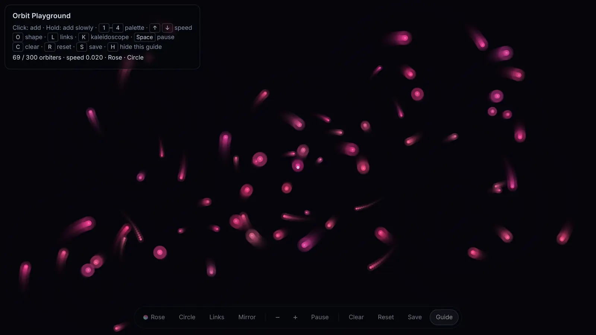
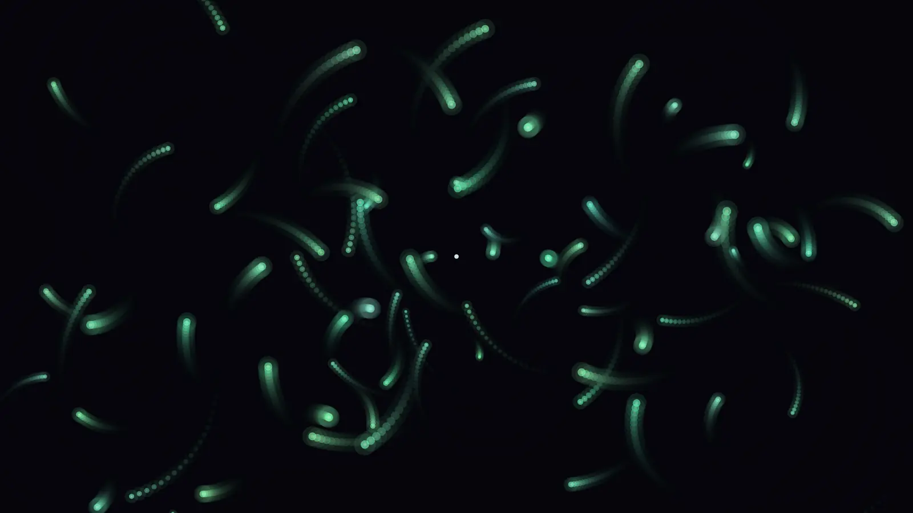
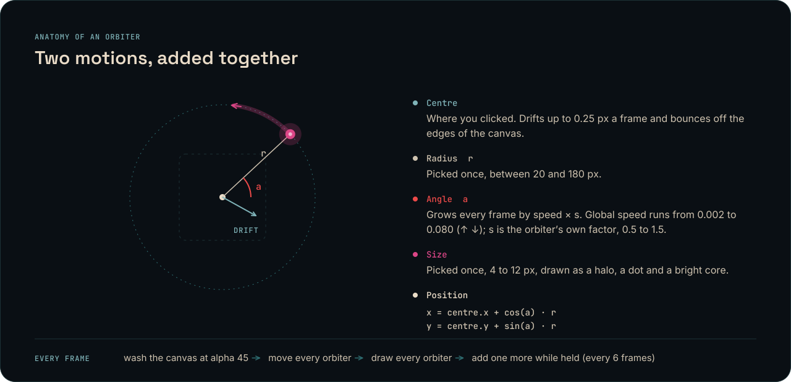

<p align="center">
  <a href="https://orbit-playground.rayhanson.tech/"></a>
</p>

<p align="center">
  <a href="https://orbit-playground.rayhanson.tech/"></a>
  
  
  
  
</p>

<p align="center">
  <a href="#about">About</a> ·
  <a href="#controls">Controls</a> ·
  <a href="#how-it-works">How it works</a> ·
  <a href="#run-it-locally">Run it locally</a> ·
  <a href="#project-layout">Layout</a> ·
  <a href="#status-and-limits">Status and limits</a> ·
  <a href="#changelog">Changelog</a>
</p>

## About

Orbit Playground turns each click into a new centre of motion. A dot appears there and starts to circle it, at its
own radius and its own pace, while the centre itself drifts slowly across the canvas. The scene starts with twenty
orbiters around the middle of the screen and builds, click by click, into overlapping trails. Three palettes and a
speed control make the same small system feel quiet, playful or restless.

It began as a creative-coding exercise for MTEC 1201, built around three ideas from the course: **loops**
(every orbiter is updated and drawn each frame), **arrays** (the orbiters live in one list) and **classes** (each
orbiter is an `Orbiter` object that knows its own centre, radius, angle and speed).

<p align="center">
  
</p>

<p align="center"><sub>Recorded from the sketch itself in a headless browser: five clicks, then <kbd>2</kbd>, then <kbd>3</kbd> and two presses of <kbd>↑</kbd>.</sub></p>

## Controls

| Input | What it does |
|---|---|
| **Click** or **tap** | Adds an orbiter that circles the point you clicked. |
| **Hold** or **drag** | Keeps adding, one orbiter every 6 frames (about ten a second). |
| <kbd>1</kbd> <kbd>2</kbd> <kbd>3</kbd> | Palette: Rose, Violet or Mint. Every orbiter changes at once. |
| <kbd>↑</kbd> <kbd>↓</kbd> | Orbital speed, in steps of 0.005, from 0.002 to 0.080. It starts at 0.020. |
| <kbd>Space</kbd> | Pauses or resumes the motion. The dots hold still and their trails fade out. |
| <kbd>C</kbd> | Clears every orbiter. |
| <kbd>R</kbd> | Restores the starting scene: 20 orbiters, Rose, speed 0.020. |
| <kbd>H</kbd> | Hides or shows the guide in the corner. |
| <kbd>S</kbd> | Saves the canvas as `orbit-playground.png`. |

There can be up to **300** orbiters at once; past that, clicks are ignored until you clear some.

<p align="center">
  
</p>

<table>
  <tr>
    <td width="50%"></td>
    <td width="50%"></td>
  </tr>
  <tr>
    <td align="center"><sub><b>Rose, at the starting speed.</b> The guide shows the count, the speed and the palette.</sub></td>
    <td align="center"><sub><b>Mint, six steps faster, guide hidden.</b> Faster orbits draw longer arcs.</sub></td>
  </tr>
</table>

## How it works

<p align="center">
  
</p>

Every orbiter is the sum of two simple motions. Its **centre** starts where you clicked and drifts by up to a quarter of
a pixel a frame, bouncing off the edges of the canvas. Around that centre, the dot moves on a **circle**: radius `r`
is chosen once (20 to 180 px), and the angle `a` grows every frame by the global speed times the orbiter's own factor
`s` (0.5 to 1.5). Because every orbiter has a different radius and factor, a crowd of them never lines up.

The trails are not stored anywhere. Each frame the whole canvas is painted with the background colour at an alpha of
45 out of 255, which fades what was drawn before a little at a time. Lower values in `TRAIL_ALPHA` give longer trails.

Each dot is drawn in three layers: a soft halo at 18% of the palette's alpha, the dot itself, and a small white core.
Every orbiter keeps a fixed offset inside its palette, so a crowd reads as one family with a little variation, and the
colours stay put when you switch palettes.

All the numbers live at the top of [`sketch.js`](sketch.js):

| Setting | Value | Meaning |
|---|---|---|
| `START_COUNT` | 20 | Orbiters in the starting scene. |
| `MAX_ORBITERS` | 300 | The most there can be at once. |
| `HOLD_INTERVAL` | 6 | Frames between new orbiters while the mouse is held. |
| `SPEED_DEFAULT`, `SPEED_STEP` | 0.020, 0.005 | Starting speed and the size of one ↑ or ↓ step. |
| `SPEED_MIN`, `SPEED_MAX` | 0.002, 0.080 | The speed range. |
| `TRAIL_ALPHA` | 45 | How much of the old picture each frame paints over. |
| `PALETTES` | Rose, Violet, Mint | Base colour, alpha and colour spread of each palette. |

### Accessibility

- With **Reduce motion** turned on in your system settings, the sketch starts at the slowest speed. You can still
  speed it up with <kbd>↑</kbd>.
- The guide is ordinary page text, not pixels on the canvas, so screen readers can read it and it never smears into
  the trails. The canvas has a text description.
- <kbd>Space</kbd> and the arrow keys never scroll the page, and touch screens don't scroll or zoom while you draw.

## Run it locally

There is nothing to install or build. p5.js loads from jsDelivr, pinned to version 1.9.4.

```bash
git clone https://github.com/Rayhanson-Git/orbit_playground.git
cd orbit_playground
python3 -m http.server 8000
```

Then open <http://localhost:8000>. Opening `index.html` directly from the file system also works.

## Project layout

```text
index.html        the page: p5.js from jsDelivr, the guide, meta and social tags
sketch.js         the whole sketch: settings, p5 hooks, the guide and the Orbiter class
style.css         full-screen canvas and the guide panel
favicon.svg       the tab icon
assets/           README images: hero, diagrams, screenshots, the demo recording and the social preview
design/           the script that draws the SVGs in assets/ (npm install && npm run build)
```

The SVG illustrations are written by [`design/artwork.mjs`](design/artwork.mjs) in the Rayhanson palette, with every
word turned into outlines so they look the same on GitHub as anywhere else. The screenshots and the recording come
from the real sketch, driven with mouse and keyboard input in a headless browser.

## Status and limits

- **Palettes and speed need a keyboard.** On a phone or tablet you can add orbiters by tapping and dragging, but the
  palette and speed keys have no on-screen buttons yet.
- **The trails leave a faint haze.** Painting over at a low alpha never quite reaches the background colour, so a
  canvas left running for a long time keeps a dim ghost of old trails. <kbd>R</kbd> clears it; resizing the window does
  too.
- **It needs a network connection the first time**, to load p5.js from jsDelivr.

## Changelog

**November 2026.** A refresh of the original December 2025 sketch. The controls and every number are unchanged.

- New: pause (<kbd>Space</kbd>), hide the guide (<kbd>H</kbd>), save a PNG (<kbd>S</kbd>), touch input, a live status line,
  Reduce Motion support, a favicon, and meta and social-preview tags.
- Fixed: the global `colorMode` variable hid p5's own `colorMode()` function; it is now `palette`.
- Fixed: after the window got smaller, orbit centres could sit outside the canvas; they are now pulled back in.
- Fixed: the arrow keys and Space could scroll the page.
- Changed: the guide moved from canvas text to an HTML panel, so it is crisp at any size and readable by screen
  readers. Dots now draw with a halo and a core, with a little colour variation inside each palette.
- Removed: commented-out code left over from Neon Orbit Arcade.

## Credits

Made by Harvey Rayhanson ([rayhanson.tech](https://rayhanson.tech)) with [p5.js](https://p5js.org). Its sibling
sketch is [Neon Orbit Arcade](https://github.com/Rayhanson-Git/neon-orbit-final). No licence has been chosen for this
repository, so all rights are reserved.
