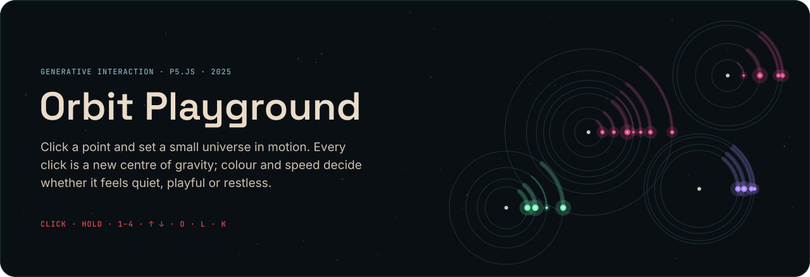
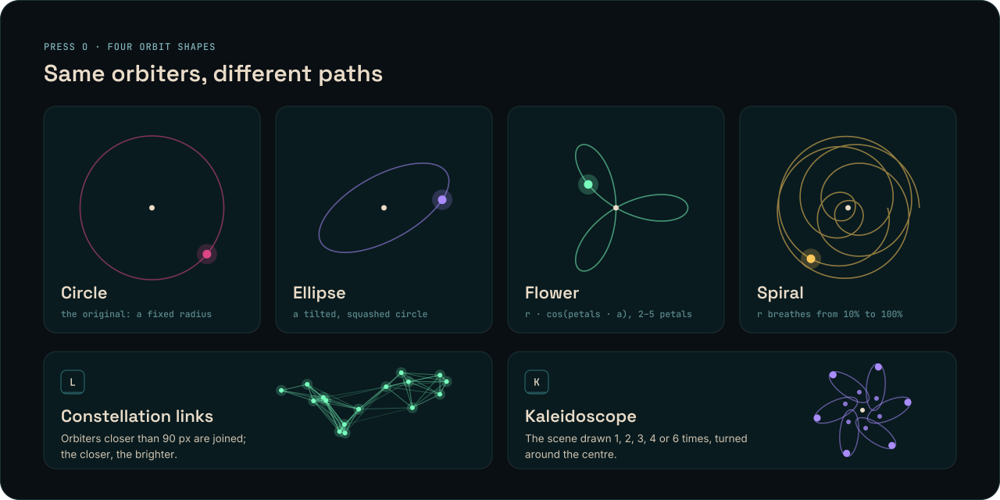
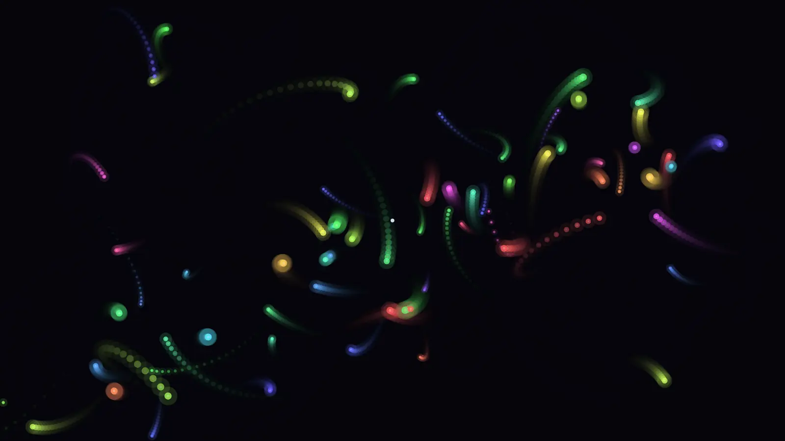
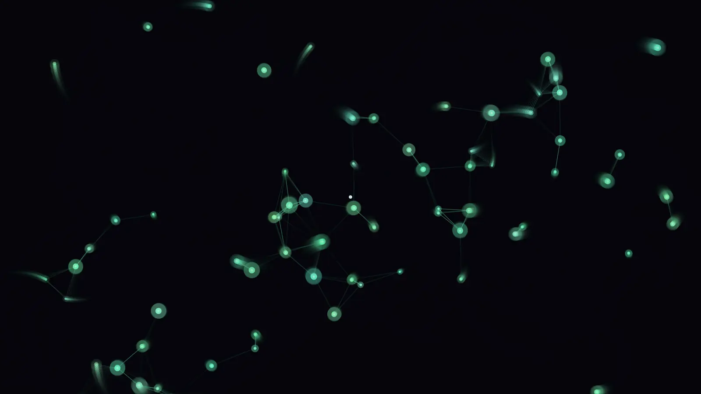
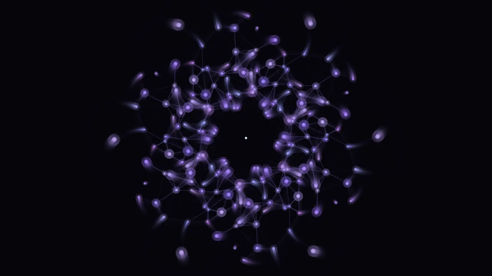
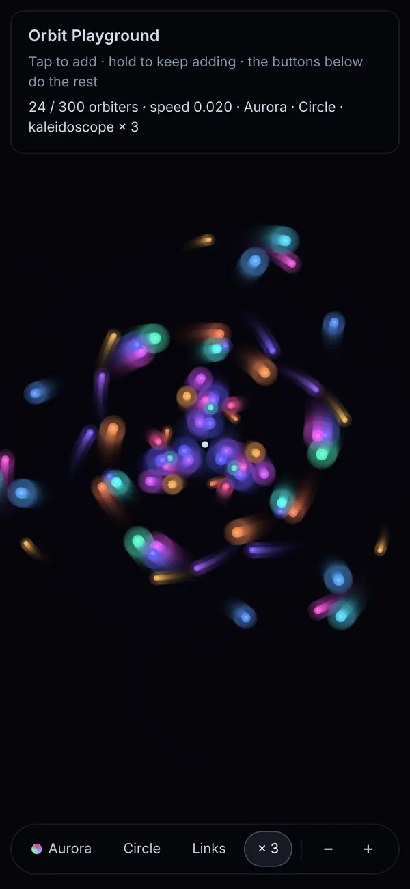

<p align="center">
  <a href="https://orbit-playground.rayhanson.tech/"></a>
</p>

<p align="center">
  <a href="https://orbit-playground.rayhanson.tech/"></a>
  
  
  
  
  
</p>

<p align="center">
  <a href="#about">About</a> ·
  <a href="#controls">Controls</a> ·
  <a href="#shapes-links-and-kaleidoscope">Shapes and kaleidoscope</a> ·
  <a href="#how-it-works">How it works</a> ·
  <a href="#run-it-locally">Run it locally</a> ·
  <a href="#project-layout">Layout</a> ·
  <a href="#status-and-limits">Status and limits</a> ·
  <a href="#changelog">Changelog</a>
</p>

## About

Orbit Playground turns each click into a new centre of motion. A dot appears there and starts to circle it, at its
own radius and its own pace, while the centre itself drifts slowly across the canvas. The scene starts with twenty
orbiters around the middle of the screen and builds, click by click, into overlapping trails.

Then you shape it. Four palettes and a speed control set the mood. Four orbit shapes turn the same crowd into circles,
tilted ellipses, flowers or breathing spirals. Constellation links join orbiters that pass close to each other, and a
kaleidoscope repeats the whole scene up to six times around the centre. Every control is on the keyboard and on a
dock of buttons, so it plays the same on a phone, and your choices are remembered for the next visit.

It began as a creative-coding exercise for MTEC 1201, built around three ideas from the course: **loops** (every
orbiter is updated and drawn each frame), **arrays** (the orbiters live in one list) and **classes** (each orbiter is
an `Orbiter` object that knows its own centre, radius, angle and speed).

<p align="center">
  
</p>

<p align="center"><sub>Recorded from the sketch itself in a headless browser: five clicks, then Aurora with Flower, then Mint with links, then Violet ellipses in a six-fold kaleidoscope.</sub></p>

## Controls

Every key has a button on the dock at the bottom of the screen. The dock stays dim so it doesn't compete with the
drawing, and brightens when you point at it; on touch screens it is always fully visible.

| Input | Dock | What it does |
|---|---|---|
| **Click** or **tap** | | Adds an orbiter that circles the point you clicked. |
| **Hold** or **drag** | | Keeps adding, one orbiter every 6 frames (about ten a second). |
| <kbd>1</kbd> <kbd>2</kbd> <kbd>3</kbd> <kbd>4</kbd> | Palette | Rose, Violet, Mint or Aurora. Every orbiter changes at once. |
| <kbd>↑</kbd> <kbd>↓</kbd> | + − | Orbital speed, in steps of 0.005, from 0.002 to 0.080. It starts at 0.020. |
| <kbd>O</kbd> | Shape | Orbit shape: Circle, Ellipse, Flower or Spiral. |
| <kbd>L</kbd> | Links | Constellation lines between orbiters closer than 90 px. |
| <kbd>K</kbd> | Mirror | Kaleidoscope: the scene drawn 1, 2, 3, 4 or 6 times around the centre. |
| <kbd>Space</kbd> | Pause | Pauses or resumes. The dots hold still and their trails fade out. |
| <kbd>C</kbd> | Clear | Clears every orbiter. |
| <kbd>R</kbd> | Reset | Restores the starting scene: 20 orbiters, Rose, Circle, speed 0.020, no links, no kaleidoscope. |
| <kbd>H</kbd> | Guide | Hides or shows the guide in the corner. |
| <kbd>S</kbd> | Save | Saves the canvas as `orbit-playground.png`. |

There can be up to **300** orbiters at once; past that, new ones are ignored until you clear some. Palette, speed,
shape, links and kaleidoscope are remembered in your browser between visits.

<p align="center">
  
</p>

## Shapes, links and kaleidoscope

<p align="center">
  
</p>

Each orbiter is given everything every shape needs when it is born: a tilt and a squash for the ellipse, a number of
petals for the flower, a starting phase for the spiral and a starting hue for Aurora. Switching shape changes only the
formula that turns its angle into a position, so the crowd morphs in place and nothing is lost.

<table>
  <tr>
    <td width="50%"></td>
    <td width="50%"></td>
  </tr>
  <tr>
    <td align="center"><sub><b>Rose, Circle.</b> The guide shows the count, speed, palette and shape; the dock sits at the bottom.</sub></td>
    <td align="center"><sub><b>Aurora, Flower.</b> Each dot changes hue as it travels its petals.</sub></td>
  </tr>
  <tr>
    <td width="50%"></td>
    <td width="50%"></td>
  </tr>
  <tr>
    <td align="center"><sub><b>Mint, Spiral, links on.</b> The closer two orbiters pass, the brighter their line.</sub></td>
    <td align="center"><sub><b>Violet, Ellipse, kaleidoscope × 6.</b> Four clicks are enough for a mandala.</sub></td>
  </tr>
</table>

<p align="center">
  
</p>

<p align="center"><sub>On a 390 × 844 phone screen, with taps and the dock only: Aurora in a three-fold kaleidoscope.</sub></p>

## How it works

<p align="center">
  
</p>

Every orbiter is the sum of two simple motions. Its **centre** starts where you clicked and drifts by up to a quarter of
a pixel a frame, bouncing off the edges of the canvas. Around that centre, the dot travels its **orbit**: radius `r` is
chosen once (20 to 180 px), and the angle `a` grows every frame by the global speed times the orbiter's own factor `s`
(0.5 to 1.5). Because every orbiter has a different radius and factor, a crowd of them never lines up.

The trails are not stored anywhere. Each frame the whole canvas is painted with the background colour at an alpha of
45 out of 255, which fades what was drawn before a little at a time. Lower values in `TRAIL_ALPHA` give longer trails.

Each frame runs in three steps:

1. **Move.** Every orbiter advances its angle and its drifting centre, and works out its position for the current
   shape. Positions are computed once, however many kaleidoscope copies there are.
2. **Draw, once per copy.** With the kaleidoscope on, the canvas is turned around its centre by 360° ÷ copies before
   each copy is drawn. Links come first, then the dots: a soft halo at 18% of the palette's alpha, the dot, and a small
   white core.
3. **Links, cheaply.** Pairs closer than 90 px are sorted into four brightness bands, and each band is stroked as a
   single canvas path. That is far cheaper than one p5 `line()` call per pair, and a per-frame limit of 1,500 links
   keeps a tight crowd from stalling the sketch.

All the numbers live at the top of [`sketch.js`](sketch.js):

| Setting | Value | Meaning |
|---|---|---|
| `START_COUNT` | 20 | Orbiters in the starting scene. |
| `MAX_ORBITERS` | 300 | The most there can be at once. |
| `HOLD_INTERVAL` | 6 | Frames between new orbiters while the mouse is held. |
| `SPEED_DEFAULT`, `SPEED_STEP` | 0.020, 0.005 | Starting speed and the size of one ↑ or ↓ step. |
| `SPEED_MIN`, `SPEED_MAX` | 0.002, 0.080 | The speed range. |
| `TRAIL_ALPHA` | 45 | How much of the old picture each frame paints over. |
| `LINK_DISTANCE`, `MAX_LINKS` | 90 px, 1,500 | How close two orbiters must be to link, and the most links drawn in a frame. |
| `SYMMETRIES` | 1, 2, 3, 4, 6 | The kaleidoscope steps. |
| `SHAPES` | Circle, Ellipse, Flower, Spiral | The orbit shapes, in the order <kbd>O</kbd> cycles them. |
| `PALETTES` | Rose, Violet, Mint, Aurora | Base colour, alpha and colour spread of each palette. |

### Accessibility

- With **Reduce motion** turned on in your system settings, the sketch starts at the slowest speed. You can still
  speed it up.
- The guide and the dock are ordinary page elements, not pixels on the canvas: screen readers read them, the buttons
  work from the keyboard with visible focus, and toggles report their state (`aria-pressed`).
- <kbd>Space</kbd> and the arrow keys never scroll the page, and touch screens don't scroll or zoom while you draw.

## Run it locally

There is nothing to install or build. p5.js loads from jsDelivr, pinned to version 1.9.4.

```bash
git clone https://github.com/Rayhanson-Git/orbit_playground.git
cd orbit_playground
python3 -m http.server 8000
```

Then open <http://localhost:8000>. Opening `index.html` directly from the file system also works.

## Project layout

```text
index.html        the page: p5.js from jsDelivr, the guide, the dock, meta and social tags
sketch.js         the whole sketch: settings, p5 hooks, actions, links, the dock and the Orbiter class
style.css         full-screen canvas, the guide panel and the dock
favicon.svg       the tab icon
assets/           README images: hero, diagrams, screenshots, the demo recording and the social preview
design/           the script that draws the SVGs in assets/ (npm install && npm run build)
```

The SVG illustrations are written by [`design/artwork.mjs`](design/artwork.mjs) in the Rayhanson palette, with every
word turned into outlines so they look the same on GitHub as anywhere else. The orbit shapes in them are drawn from the
same formulas as the sketch. The screenshots and the recording come from the real sketch, driven with mouse, touch and
keyboard input in a headless browser.

## Status and limits

- **The kaleidoscope multiplies the drawing.** Six copies of 300 orbiters with links is the heaviest scene: on a
  machine without graphics acceleration it drops to around 20 to 40 frames a second. One copy, or fewer orbiters, stays
  at 60.
- **The trails leave a faint haze.** Painting over at a low alpha never quite reaches the background colour, so a
  canvas left running for a long time keeps a dim ghost of old trails. <kbd>R</kbd>, a kaleidoscope change or resizing
  the window clears it.
- **It needs a network connection the first time**, to load p5.js from jsDelivr.

## Changelog

**November 2026: the upgrade.** The original December 2025 sketch, grown into an instrument for making pictures. Every
original control and number still works the same way.

- **Orbit shapes** (<kbd>O</kbd>): Circle, Ellipse, Flower and Spiral, switchable at any time without losing the scene.
- **Constellation links** (<kbd>L</kbd>) between orbiters that pass within 90 px, drawn in four batched bands.
- **Kaleidoscope** (<kbd>K</kbd>): the scene repeated 1, 2, 3, 4 or 6 times around the centre.
- **Aurora** (<kbd>4</kbd>), a fourth palette in which each orbiter moves through the hues as it travels.
- **The dock**: every control as a button, so the whole sketch works on phones and tablets.
- **Remembered settings**: palette, speed, shape, links and kaleidoscope are kept between visits.
- Pause (<kbd>Space</kbd>), hide the guide (<kbd>H</kbd>), save a PNG (<kbd>S</kbd>), a live status line, Reduce
  Motion support, a favicon, and meta and social-preview tags.
- Fixed: the global `colorMode` variable hid p5's own `colorMode()` function; it is now `palette`.
- Fixed: after the window got smaller, orbit centres could sit outside the canvas; they are now pulled back in.
- Fixed: the arrow keys and Space could scroll the page; speed steps no longer collect floating-point drift.
- Changed: the guide moved from canvas text to an HTML panel. Dots draw with a halo and a core, with a little colour
  variation inside each palette.
- Removed: commented-out code left over from Neon Orbit Arcade.

## Credits

Made by Harvey Rayhanson ([rayhanson.tech](https://rayhanson.tech)) with [p5.js](https://p5js.org). Its sibling
sketch is [Neon Orbit Arcade](https://github.com/Rayhanson-Git/neon-orbit-final). No licence has been chosen for this
repository, so all rights are reserved.
